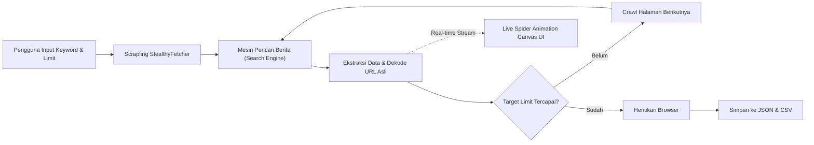

# 🕷️ Erlangs Scraping Spider 


[](https://www.python.org/)
[](https://github.com/D4Vinci/Scrapling)
[]()
[]()

Aplikasi web crawler dan scraping berita modern berbasis Python menggunakan **Scrapling** (`StealthyFetcher`). Dilengkapi dengan mesin pencari berita lintas domain (*multi-domain*) serta antarmuka web (**Interactive Live Spider Radar UI**) yang menampilkan animasi laba-laba interaktif saat proses perayapan berlangsung.

---

## 📌 Daftar Isi
- [Fitur Utama](#-fitur-utama)
- [Cara Kerja Sistem](#-cara-kerja-sistem)
- [Struktur Repositori](#-struktur-repositori)
- [Persyaratan Sistem](#-persyaratan-sistem)
- [Panduan Instalasi](#-panduan-instalasi)
  - [Windows](#1-instalasi-di-windows)
  - [Linux (Ubuntu / Debian / Arch / Fedora)](#2-instalasi-di-linux)
- [Panduan Penggunaan](#-panduan-penggunaan)
  - [A. Menjalankan Spider Web UI (Rekomendasi)](#a-menjalankan-spider-web-ui-rekomendasi)
  - [B. Menjalankan via Terminal CLI](#b-menjalankan-via-terminal-cli)
- [Format Output Data](#-format-output-data)
- [Troubleshooting & Solusi Masalah](#-troubleshooting--solusi-masalah)
- [Disclaimer](#-disclaimer)

---

## ✨ Fitur Utama

1. **Bebas Semua Domain (*Search Engine Multi-Domain*)**:
   Tidak terkunci pada satu portal berita. Mengambil artikel dari media mana saja di internet (**Kompas, Detik, Liputan6, CNN Indonesia, Tempo, Tirto, Kumparan, dll**).
2. **Stealth & Anti-Bot Bypass Bawaan**:
   Ditenagai oleh `StealthyFetcher` dari Scrapling (Patchright/Chromium) yang otomatis memalsukan TLS fingerprint dan menghindari proteksi Cloudflare/WAF.
3. **Penyelamatan Otomatis URL Asli (*URL Decoder*)**:
   Otomatis mendekode redirect tracking link mesin pencari (Bing/Search Engine) menjadi tautan bersih ke artikel asli penerbit berita.
4. **Pembatas Kuota Cerdas (*Auto-Exit Limit*)**:
   Proses scraping langsung berhenti seketika saat kuota target (misal 20 berita) terpenuhi, mencegah pemborosan bandwidth dan memori.
5. **Dashboard Web dengan Animasi Laba-Laba (*Spider Canvas*)**:
   Animasi laba-laba interaktif dengan 8 kaki bersendi, radar sonar pemindai, jaring web dinamis, dan efek partikel data yang bergerak secara *real-time*.
6. **Ekspor Data Sekali Klik**:
   Hasil langsung disimpan dan dapat diunduh dalam format **JSON** dan **CSV** yang rapi.

---

## 🧠 Cara Kerja Sistem



1. **Penerimaan Parameter**: Pengguna menentukan kata kunci (misal *"ijazah jokowi"*), batas jumlah berita, dan mode browser (*GUI* atau *Headless*).
2. **Perayapan Tersembunyi (*Stealth Navigation*)**: Browser Chromium anti-deteksi membuka mesin pencari berita dengan *browser fingerprinting* yang menyerupai pengguna manusia.
3. **Pengambilan Kartu Berita**: Elemen judul, penerbit, domain asli, tanggal terbit, cuplikan ringkasan, dan tautan artikel diekstrak secara otomatis.
4. **Pembaruan Visual**: Selama proses berlangsung, server lokal mengalirkan log proses ke antarmuka web, menggerakkan animasi laba-laba ke node domain yang bersangkutan.
5. **Penyimpanan**: Hasil perayapan diformat rapi dan disimpan otomatis ke file `.json` dan `.csv`.

---

## 📁 Struktur Repositori

```text
scraping-demo/
├── app.py                     # Web Dashboard UI + Live Canvas Spider Animation
├── scrape_berita.py           # Skrip CLI untuk eksekusi cepat lewat terminal
├── requirements.txt           # Daftar dependensi paket Python
├── README.md                  # Dokumentasi proyek (file ini)
├── .gitignore                 # File pengabaian Git (venv, cache, temporary files)
├── berita_ijazah_jokowi.json  # Output sampel data format JSON
└── berita_ijazah_jokowi.csv   # Output sampel data format CSV
```

---

## ⚙️ Persyaratan Sistem

- **Python**: Versi `3.10` atau lebih tinggi
- **Sistem Operasi**: Windows 10/11 atau Linux (Ubuntu 20.04+, Debian 11+, Arch Linux, Fedora)
- **Koneksi Internet** yang stabil

---

## 📦 Panduan Instalasi

### 1. Instalasi di Windows

Buka **PowerShell** atau **Command Prompt** di folder proyek ini:

```powershell
# 1. Buat virtual environment
python -m venv venv

# 2. Aktifkan virtual environment
.\venv\Scripts\activate

# 3. Instal dependensi Scrapling
pip install -r requirements.txt

# 4. Unduh binary browser anti-deteksi
scrapling install
```

> **Tips Windows:** Jika saat menjalankan `activate` muncul peringatan script policy, jalankan perintah ini terlebih dahulu di PowerShell:
> ```powershell
> Set-ExecutionPolicy -Scope Process -ExecutionPolicy Bypass
> ```
> Atau Anda bisa langsung memanggil interpreter virtual environment tanpa aktivasi: `.\venv\Scripts\python.exe app.py`.

---

### 2. Instalasi di Linux

Buka **Terminal** di folder proyek ini:

```bash
# 1. Pastikan python3-venv dan curl terpasang (Khusus Debian/Ubuntu)
sudo apt update && sudo apt install -y python3-venv python3-pip

# 2. Buat virtual environment
python3 -m venv venv

# 3. Aktifkan virtual environment
source venv/bin/activate

# 4. Instal dependensi Scrapling
pip install -r requirements.txt

# 5. Unduh binary browser anti-deteksi
scrapling install

# 6. Pasang dependensi sistem browser (Opsional, jika menggunakan Linux Server/Headless)
playwright install-deps
```

---

## 🚀 Panduan Penggunaan

### A. Menjalankan Spider Web UI (Rekomendasi)

Jalankan server aplikasi web lokal:

**Di Windows:**
```powershell
.\venv\Scripts\python.exe app.py
```

**Di Linux:**
```bash
./venv/bin/python3 app.py
```

1. Browser akan otomatis terbuka ke alamat **`http://localhost:5000`**.
2. Masukkan kata kunci pencarian berita yang Anda inginkan.
3. Atur target batas jumlah artikel (default: 20 berita).
4. Centang atau uncentang opsi **"Buka Jendela Browser"** (GUI vs Headless).
5. Klik **"🚀 Mulai Crawling Berita"**.
6. Anda dapat melihat animasi laba-laba merayap dan memindai jaring web secara langsung sembari artikel ditangkap satu per satu.
7. Klik tombol **📥 Unduh CSV** atau **📥 Unduh JSON** untuk mengunduh data.

---

### B. Menjalankan via Terminal (CLI)

Jika ingin menjalankan scraping langsung dari baris perintah terminal tanpa membuka dashboard web:

**Di Windows:**
```powershell
# Default: mencari 'ijazah jokowi' dengan batas 20 berita
.\venv\Scripts\python.exe scrape_berita.py --limit 20

# Mengganti kata kunci dan batas jumlah
.\venv\Scripts\python.exe scrape_berita.py --keyword "sidang ijazah jokowi" --limit 15

# Mode background (tanpa popup jendela browser visual)
.\venv\Scripts\python.exe scrape_berita.py --headless --limit 10

# Menentukan nama file output
.\venv\Scripts\python.exe scrape_berita.py --keyword "pemilu 2026" --output hasil_pemilu --limit 25
```

**Di Linux:**
```bash
# Default
./venv/bin/python3 scrape_berita.py --limit 20

# Kustomisasi kata kunci & mode headless
./venv/bin/python3 scrape_berita.py --keyword "sidang ijazah jokowi" --headless --limit 15
```

#### Opsi Parameter CLI (`scrape_berita.py`):
| Parameter | Default | Deskripsi |
| :--- | :--- | :--- |
| `--keyword`, `-k` | `"ijazah jokowi"` | Kata kunci pencarian berita |
| `--limit`, `-l` | `20` | Batas maksimal jumlah berita yang diambil |
| `--max-pages`, `-p`| `5` | Batas maksimal halaman mesin pencari yang diperiksa |
| `--headless` | `False` | Berjalan di latar belakang tanpa membuka jendela GUI browser |
| `--output`, `-o` | `"berita_ijazah_jokowi"`| Prefix nama file hasil penyimpanan (`.json` & `.csv`) |

---

## 📊 Format Output Data

Hasil scraping disimpan dalam dua format yang siap diolah untuk analisis data atau database:


### 2. Format CSV (`berita_ijazah_jokowi.csv`)

---

## 🛠️ Troubleshooting & Solusi Masalah

1. **Error `python` / `pip` tidak ditemukan di Linux:**
   Pastikan paket Python telah terinstal dengan menjalankan `sudo apt install python3 python3-pip python3-venv`.

2. **Error `Host system is missing dependencies to run browsers` di Linux Server:**
   Jalankan perintah ini di terminal Linux Anda:
   ```bash
   playwright install-deps
   ```

3. **Port 5000 sudah digunakan:**
   Jika port 5000 sedang terpakai oleh aplikasi lain di komputer Anda, Anda dapat mengganti port pada baris terakhir file `app.py`:
   ```python
   run_server(port=5050)
   ```

4. **Koneksi Jaringan Timeout:**
   Jika koneksi internet lambat, parameter `timeout=30000` (30 detik) pada `StealthyFetcher.fetch` dapat dinaikkan sesuai kebutuhan di file `app.py` atau `scrape_berita.py`.

---

## ⚖️ Disclaimer

Aplikasi ini ditujukan murni untuk keperluan **edukasi, riset, dan analisis data pribadi**. Harap mematuhi syarat dan ketentuan layanan (*Terms of Service*) dari mesin pencari dan portal berita yang Anda tuju, serta perhatikan frekuensi permintaan agar tidak membebani server target (*ethical web scraping*).
